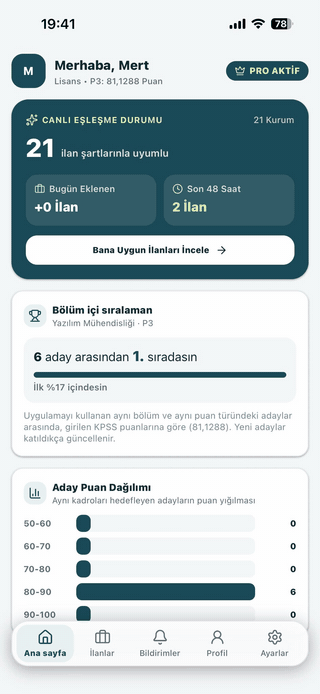
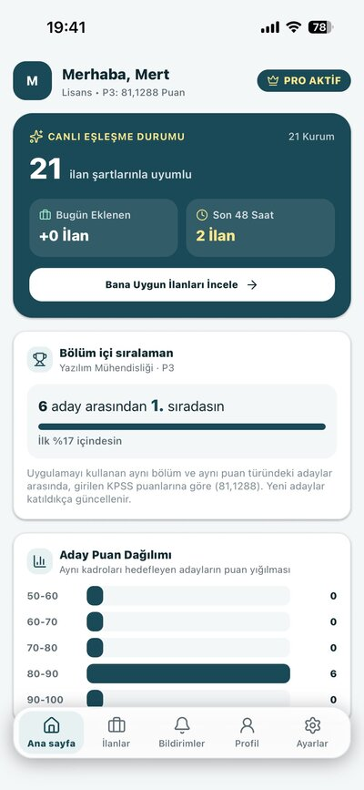
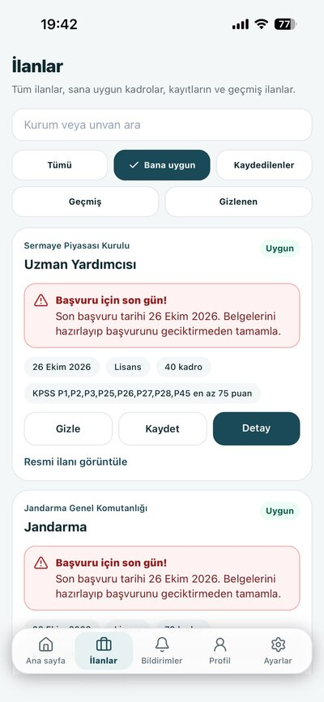
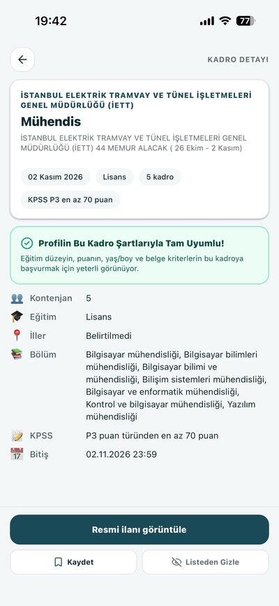
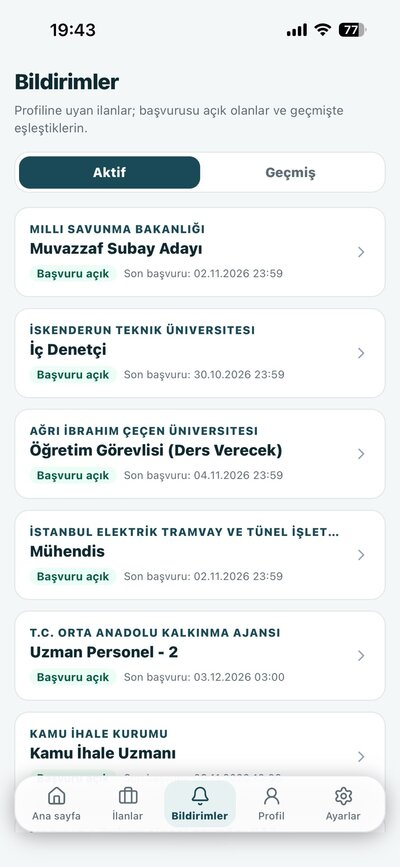
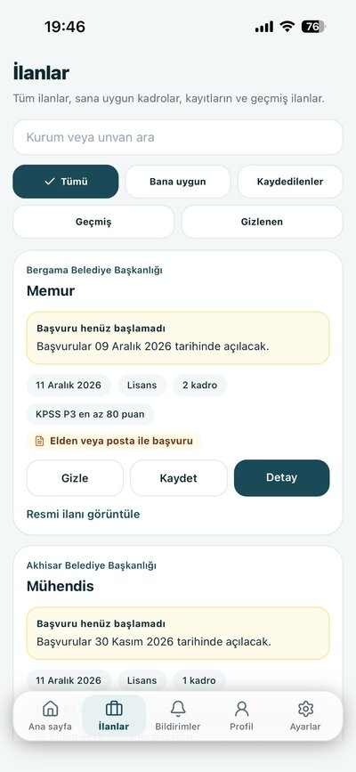
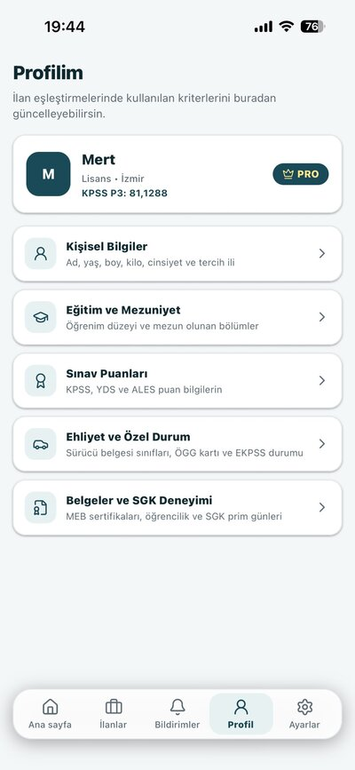
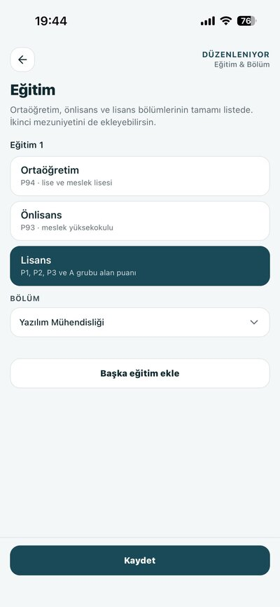
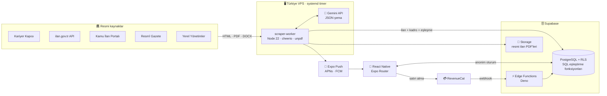

 

> 🔒 Kaynak kod private. Bu repo uygulamanın vitrini: ne yaptığı, nasıl kurulduğu ve hangi teknik problemleri çözdüğü. Mülakatlarda kod üzerinden anlatmaktan memnuniyet duyarım.

---

## 🎬 Uygulama Turu

---

## 💡 Problem → Çözüm

😵‍💫 **Problem:** Kamu personel ilanları Kariyer Kapısı, ilan.gov.tr, Resmî Gazete ve onlarca belediye sitesine dağılmış durumda. Her ilanın içinde farklı şartlara sahip onlarca kadro var. Aday hepsini tek tek açıp *"bölümüm, puan türüm, yaşım, ehliyetim tutuyor mu?"* diye bakmak zorunda.

✅ **Çözüm:** Profilini bir kez gir. KPSS Atama her gün ilanları toplar, yapay zekâyla kadro satırlarına ayırır ve sadece **şartlarını karşıladığın** kadroları önüne getirir.

---

## 📱 Ekranlar

| 🏠 Ana sayfa | 🎯 Bana uygun | 📄 Kadro detayı | 🔔 Bildirimler |
|:-:|:-:|:-:|:-:|
|  |  |  |  |
| Canlı eşleşme durumu, son 48 saat, bölüm içi sıralama | Uygun kadrolar, kaydet / gizle | Şart karşılaştırması ve resmi ilan | Aktif ve geçmiş eşleşmeler |

| 📋 Tüm ilanlar | 👤 Profil | 🎓 Eğitim |
|:-:|:-:|:-:|
|  |  |  |
| Başvuru tarihi ve yöntemi | Eşleştirme kriterleri | Ortaöğretim / önlisans / lisans + bölüm |

---

## ✨ Özellikler

| | Özellik | Ayrıntı |
|:-:|---|---|
| 📢 | **5 kaynaktan ilan toplama** | Kariyer Kapısı, ilan.gov.tr, Kamu İlan Portalı, Resmî Gazete, Yerel Yönetimler — HTML, PDF ve DOCX |
| 🤖 | **Yapay zekâ ile ayrıştırma** | Gemini, ilanı yapılandırılmış JSON şemasıyla kadro satırlarına böler: unvan, bölümler, KPSS türü ve tabanı, yaş, boy, ehliyet, sertifika, SGK günü |
| 🎯 | **Kadro bazında eşleştirme** | 10+ şart aynı anda: eğitim, bölüm/grup, KPSS–EKPSS, YDS, ALES, yaş/boy/kilo, ehliyet hiyerarşisi, sertifika kapsamı, SGK günü |
| 📊 | **Bölüm içi sıralama** | "X aday arasından Y. sıradasın" kartı ve puan dağılım grafiği — kimlik göstermeden |
| ⏰ | **Son 48 saat uyarısı** | Uygun ilanın başvurusu bitmeden hatırlatma |
| 🔔 | **Özet push bildirimi** | Yeni ilan, son 48 saat, düzeltme/iptal — kişi başına tek özet |
| 👤 | **Hesapsız giriş** | E-posta/şifre yok, cihaz başına anonim Supabase oturumu |
| 💎 | **Pro abonelik** | Aylık, 3 aylık, yıllık (3 gün deneme) — RevenueCat |
| 🗑️ | **KVKK uyumlu silme** | Tek dokunuşla profil, eşleşme ve bildirim kayıtlarını silen Edge Function |

---

## 🏗️ Sistem Mimarisi

### 🔄 Bir tarama turu

1. ⏱️ **Zamanlama** — Türkiye'deki VPS'te systemd timer, Pzt–Cmt 12:00; 18:00'de yedek tur
2. 🕸️ **Toplama** — 5 sitenin okuyucusu; metni değişmemiş ilanlar `body_hash` ile atlanır
3. 🧹 **Filtreleme** — personel alımı olmayan ve akademik ilanlar elenir
4. 🤖 **Ayrıştırma** — Gemini, PDF/DOCX dahil ilanı kadrolara böler; KPSS türleri ÖSYM kodlarına (`P3`, `P93`, `P39,P40`) normalize edilir
5. 🧬 **Tekilleştirme** — aynı ilan farklı sitelerde varsa kurum adı normalizasyonuyla bir kez kaydedilir
6. 🎯 **Eşleştirme** — her kadro için SQL fonksiyonu uygun profilleri `user_matches` tablosuna yazar
7. 🔔 **Bildirim** — Pro kullanıcılara tek özet push; APNs/FCM teslim raporları okunur
8. 📝 **Kayıt** — tur sonucu, Gemini token kullanımı ve hatalar `scraper_runs` tablosuna yazılır
9. 🩺 **Sağlık kontrolü** — GitHub Actions her akşam turu denetler, sorun varsa e-posta ile uyarır

---

## 🧰 Teknoloji

| Katman | Teknoloji |
|---|---|
| 📱 Mobil | React Native 0.88 · Expo SDK 58 · Expo Router · TypeScript |
| 🎨 Arayüz | NativeWind (Tailwind) · Reanimated · Lucide |
| 🧠 Durum | Zustand (kalıcı profil) · TanStack Query (önbellek) |
| 🗄️ Veritabanı | Supabase PostgreSQL · Row Level Security · 29 migration · SQL fonksiyonları |
| ⚡ Sunucu | Supabase Edge Functions (Deno): `revenuecat-webhook`, `sync-premium`, `delete-account` |
| 🕸️ Scraper | Node 22 · cheerio · unpdf · JSZip · LibreOffice (DOCX → PDF) |
| 🤖 Yapay zekâ | Google Gemini API, yapılandırılmış çıktı (response schema) |
| 🔔 Bildirim | Expo Push · APNs · Firebase Cloud Messaging |
| 💳 Ödeme | RevenueCat · App Store / Google Play abonelikleri |
| 🚀 DevOps | EAS Build · EAS Update (OTA) · GitHub Actions CI · self-hosted runner · systemd |

---

## 🧠 Çözülen Teknik Problemler

🌍 <b>Kamu siteleri yurt dışı IP'lerini engelliyor</b>

 

GitHub Actions sunucularından yapılan istekler 403 alıyordu. Tarama Türkiye'deki bir VPS'e taşındı; zamanlamayı systemd timer belirliyor. GitHub Actions, aynı VPS'i **self-hosted runner** olarak kullanan yedek görev olarak kaldı. İki turun üst üste binmemesi için `flock` kilidi kullanılıyor.

📄 <b>Serbest metin ilanları karşılaştırılabilir veriye çevirmek</b>

 

Her kurum şartları farklı yazıyor: "en az (C) düzeyinde YDS", "3 yıl tecrübe", "E veya yeni tip D sınıfı". Gemini'ye **response schema** ile tip güvenli JSON ürettiriliyor; ardından deterministik normalizasyon katmanı devreye giriyor: YDS harf düzeyi → puan, yıl × 360 → SGK günü, seçenekli ehliyette en düşük sınıf, ilandaki program adı → katalogdaki bölüm (816 bölüm). Model uzun ilanlarda kadroları eksik okursa, metindeki kadro başlığı sayısıyla karşılaştırılıp ilan tam metinle ikinci kez okunuyor. Yarım kalan JSON cevabı ayrı bir hata tipiyle yakalanıyor ve ilan her turda tekrar gönderilmesin diye genel kadro olarak kaydediliyor. Son olarak çıkan şartlar ilan metniyle tekrar denetleniyor.

⚖️ <b>İstemci ve sunucu aynı kuralla eşleştirmeli</b>

 

Eşleştirme hem sunucuda (PostgreSQL fonksiyonu) hem uygulamada (`lib/match.ts`) çalışıyor. İkisinin ayrışmaması için parite testleri yazıldı: katalogdaki her bölüm için bir aday üretilip (824 persona) gerçek ilanlar üzerinde iki tarafın aynı sonucu verdiği doğrulanıyor. Testler CI'da her push'ta koşuyor.

🔐 <b>Pro durumunu istemciye bırakmamak</b>

 

`is_premium` alanını kullanıcı değiştiremez; RLS ve açık `GRANT`'larla korunuyor. RevenueCat webhook'u Edge Function'a geliyor, fonksiyon güncel durumu RevenueCat API'sinden doğrulayıp yazıyor. Liste, eşleşme, sıralama ve bildirim fonksiyonlarının hepsi sunucudaki tek `has_active_pro()` kontrolünü kullanıyor.

🔁 <b>Aynı bildirimin iki kez gitmemesi</b>

 

Her bildirim `dedupe_key` ile kaydediliyor. Uygulama yeniden kurulduğunda yeni anonim hesap push jetonunu `claim_push_token` ile devralıyor; böylece eski hesaba bağlı jeton çift bildirim üretmiyor. Bir turdaki tüm eşleşmeler kişi başına tek özet bildirimde toplanıyor.

💸 <b>Yapay zekâ kotasında veri kaybetmemek</b>

 

Gemini günlük kotası dolduğunda tur güvenli şekilde duruyor; işlenmemiş ilanlar bir sonraki turda alınıyor. Tur başına üst sınır (150 yeni ilan) ve token kullanımı `scraper_runs` kaydına yazılıyor. Toplam altyapı maliyeti ayda birkaç dolar.

---

## 🔐 Gizlilik

- 🙈 Başka bir adayın kimliği hiçbir ekranda gösterilmez; sıralama yalnızca sayı olarak görünür
- 🧾 Aday profili Gemini'ye **gönderilmez**; yapay zekâ yalnızca kamuya açık ilan metnini işler
- 🚫 Reklam, reklam kimliği, konum ve çerez yok
- ⚖️ 6698 sayılı KVKK kapsamında erişim ve silme talepleri desteklenir
- 📄 [Gizlilik politikası](https://mertglbyz.github.io/KPSS_Atama_Support/privacy-policy/) · [Kullanım koşulları](https://mertglbyz.github.io/KPSS_Atama_Support/terms/)

> ⚠️ KPSS Atama bir kamu kurumu uygulaması değildir. Listede yer almak başvuru veya atama hakkı doğurmaz; başvurudan önce ilanın resmi metni kontrol edilmelidir.

---

## 👨‍💻 Geliştirici

**Mert Gülbeyaz** — Mobile App Developer | AI/ML Engineer

